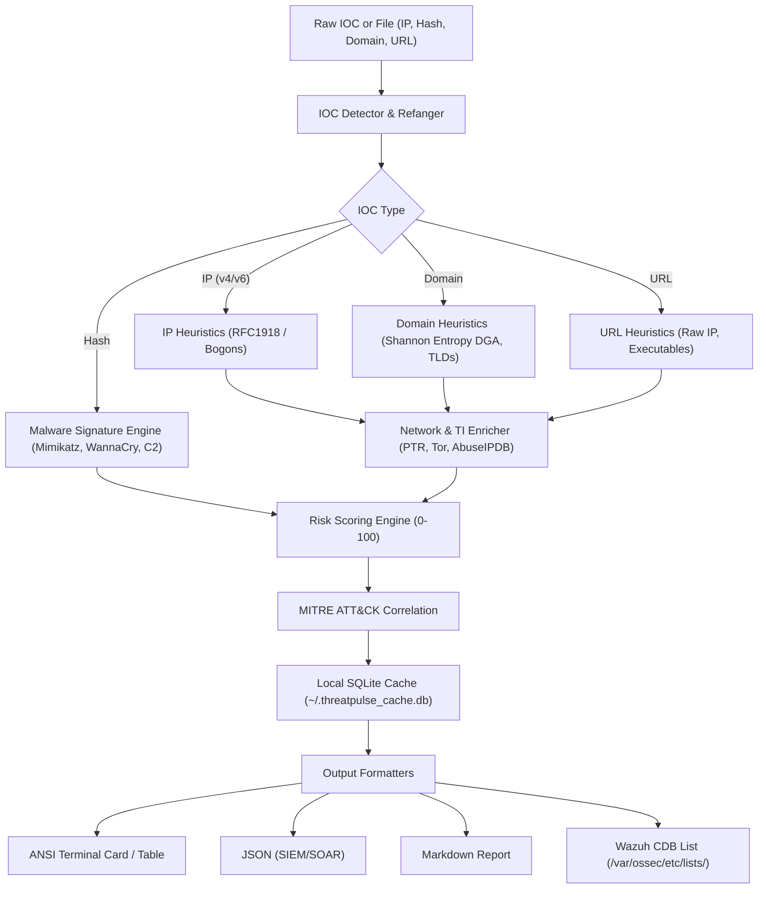

# ThreatPulse (v1.0.0) ⚡

[](https://github.com/Voobrazhenie21-lab/threat-pulse/actions/workflows/ci.yml)
[](#2-running-via-docker-)
[](https://python.org)
[](https://voobrazhenie21-lab.github.io/threat-pulse/)
[](https://opensource.org/licenses/MIT)
[-success.svg)](pyproject.toml)
[](https://attack.mitre.org/)
[](https://wazuh.com)

**Fast, zero-dependency Threat Intelligence & IOC enrichment CLI built for SOC Analysts, Incident Responders, and Blue Teams.**

> 🌐 **[Try the Interactive Live Web Demo on GitHub Pages](https://voobrazhenie21-lab.github.io/threat-pulse/)**

```text
  _____ _                         _   _____       _           
 |_   _| |                       | | |  __ \     | |          
   | | | |__  _ __ ___  __ _  ___| |_| |__) |   _| |___  ___ 
   | | | '_ \| '__/ _ \/ _` |/ _ \ __|  ___/ | | | / __|/ _ \
   | | | | | | | |  __/ (_| |  __/ |_| |   | |_| | \__ \  __/
   \_/ |_| |_|_|  \___|\__,_|\___|\__|_|    \__,_|_|___/\___|
             SOC Threat Intelligence & IOC Triage Engine
```

---

## 🎯 The Problem ThreatPulse Solves

In enterprise Security Operations Centers (SOC L1/L2), analysts suffer from severe **alert fatigue**. Every incoming alert contains raw IPs, domains, and file hashes. Manually copying and pasting indicators into VirusTotal, AbuseIPDB, and WHOIS takes several minutes per ticket.

**ThreatPulse** automates this triage pipeline in milliseconds:
1. **Auto-Detects IOC Types:** IPv4, IPv6, Domains, URLs, MD5, SHA1, SHA256.
2. **Offline Heuristics & Fast Filtering:** Instantly recognizes **RFC 1918** private corporate IPs (`10.0.0.0/8`, `172.16.0.0/12`, `192.168.0.0/16`), Loopback, and Bogon spaces to prevent false-positive alarms.
3. **Shannon Entropy (DGA Detection):** Analyzes domain name character entropy to flag machine-generated botnet domains (DGA).
4. **Threat Intelligence Aggregation:** Correlates AbuseIPDB scores, Tor exit nodes, and active internet research scanners (Shadowserver, Censys, Shodan).
5. **Malware Signature Database:** Identifies critical ransomware and credential dumping signatures (WannaCry, Mimikatz, Cobalt Strike, China Chopper).
6. **MITRE ATT&CK Mapping & Actionable Advice:** Generates direct tactical recommendations for containment.
7. **Wazuh CDB List Exporter:** Exports malicious IOCs directly into Wazuh CDB list syntax (`ioc:verdict:tags`) for instant SIEM rule lookups!

---

## 🏗️ Architecture



---

## 🚀 Quick Start

### 1. Installation (via uv or pip)

ThreatPulse is completely self-contained using Python's standard library. No third-party runtime dependencies required!

```bash
# Clone the repository
git clone https://github.com/Voobrazhenie21-lab/threat-pulse.git
cd threat-pulse

# Install with uv
uv venv
uv pip install -e .

# Or run directly via Python
python -m threat_pulse --version
```

### 2. Running via Docker 🐳

Run ThreatPulse in an isolated, secure non-root Alpine container without needing Python installed on the host system:

```bash
# Build the lightweight Alpine image (~45MB)
docker build -t threat-pulse .

# Inspect a single indicator directly
docker run --rm threat-pulse 185.220.101.5

# Analyze a log file and export to Wazuh CDB list format
docker run --rm -v $(pwd):/data threat-pulse -f /data/samples/sample_iocs.txt --format wazuh-cdb
```

### 3. Single Indicator Inspection

```bash
# Analyze a known Tor Exit Node
threat-pulse 185.220.101.5

# Analyze a malware hash (Mimikatz)
threat-pulse a60c52bb53a5c0b89cf53dc5bb7c2c129219b16e4ee7d9c6e3b5e43a9b1c9d2f

# Analyze a suspicious DGA domain
threat-pulse xkjqpw987dfghk123498.top
```

### 4. Batch Triage from Log Files

Extract all IOCs from an access log, firewall dump, or ticket export and render a summary table:

```bash
threat-pulse -f samples/sample_iocs.txt --format table
```

### 5. Exporting to Wazuh SIEM CDB Lists

```bash
threat-pulse -f samples/sample_iocs.txt --format wazuh-cdb -o /var/ossec/etc/lists/threat_pulse.cdb
```

### 6. Quick Defanging & Refanging Helpers

```bash
# Defang a dangerous URL for safe sharing
threat-pulse --defang http://malicious-site.com/payload.exe
# Output: hxxp://malicious-site[.]com/payload.exe

# Refang back to canonical form
threat-pulse --refang hxxps://c2-botnet[.]xyz/beacon
# Output: https://c2-botnet.xyz/beacon
```

---

## 📊 Terminal Output Example

```text
┌────────────────────────────────────────────────────────────────────────┐
│ ThreatPulse IOC Report  [IPV4]
├────────────────────────────────────────────────────────────────────────┤
│ Indicator:    185[.]220[.]101[.]5 (raw: 185.220.101.5)
│ Risk Level:   HIGH (85/100) 
│ Verdict:      High Risk Indicator
│ Tags:         #Tor-Exit-Node #Anonymizer
│ MITRE ATT&CK:
│   • T1090.003: Multi-hop Proxy: Tor
│ Intelligence Details:
│   • Reverse DNS: tor-exit-5.relay.org
│ SOC Action:   Isolate traffic, block domain/IP at proxy, verify if any endpoint established persistent C2 connection.
│ Timestamp: 2026-10-14T21:10:00Z (live analysis)
└────────────────────────────────────────────────────────────────────────┘
```

---

## ⚙️ Configuration & API Keys

ThreatPulse works **100% out of the box** using offline heuristics, local signature matching, and reverse DNS.

To enable live **AbuseIPDB** API lookups:
```bash
export ABUSEIPDB_API_KEY="your_api_key_here"
# Or pass directly:
threat-pulse 1.2.3.4 --api-key "your_api_key_here"
```

---

## 🧪 Testing

Comprehensive test suite covering heuristics, entropy, MITRE mapping, SQLite caching, and formatters:

```bash
uv run pytest tests/ -v
```

---

## 👤 Author

**Aleksei Zharkou**  
- **GitHub:** [@Voobrazhenie21-lab](https://github.com/Voobrazhenie21-lab)  
- **LinkedIn:** [Aleksei Zharkou](https://www.linkedin.com/in/aleksei-zharkou/)  
- **Portfolio:** [voobrazhenie21-lab.github.io](https://voobrazhenie21-lab.github.io/)

---

## 📄 License

This project is licensed under the [MIT License](LICENSE).
